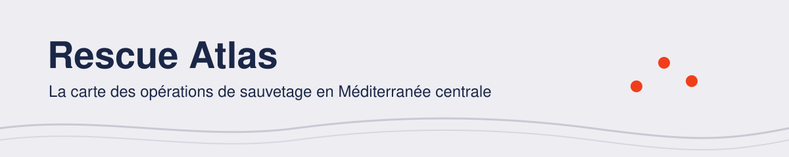

<picture>
  <source media="(prefers-color-scheme: dark)" srcset=".github/assets/banniere-sombre.svg">
  
</picture>

  
  
  

SOS MEDITERRANEE recherche et secourt les personnes en détresse en Méditerranée centrale. Avec
les bénévoles de [Data for Good](https://dataforgood.fr/), on fait vivre la
[carte publique de ses opérations](https://map.sosmediterranee.org/) : pour la transparence, le
plaidoyer et la collecte de fonds.

> Une carte qui ne s'éteint jamais. Sans effort pour l'équipe, indéniable pour le monde, et
> pensée pour aller plus loin : expliquer le coût de chaque traversée, l'impact des politiques,
> la réalité de chaque incident. Un socle de preuves vivant, au service du plaidoyer et de la
> levée de fonds de SOS MEDITERRANEE.
>
> La vision du projet, écrite par l'équipe produit

> [!NOTE]
> **Le projet démarre.** Ce dépôt contient une API FastAPI et une app React tout juste créées,
> avec une base Postgres vide. Chaque pièce arrive par une issue. La pile et ses raisons sont dans
> [TECHNICAL.md](TECHNICAL.md).

## Contribuer

1. Présente-toi sur le canal du projet, sur le Mattermost de Data for Good.
2. Lis [CONTRIBUTING.md](CONTRIBUTING.md) : le chemin d'une issue jusqu'au merge.
3. Lance le projet avec [TECHNICAL.md](TECHNICAL.md) : `docker compose -f docker-compose.dev.yaml up` suffit.
4. Prends une issue `good first issue`, puis suis la [progression](docs/progression.md).

Épopée, activité, jalon, sprint : [De la storymap à GitHub](docs/storymap-et-github.md) explique
comment le travail de l'équipe produit devient des issues.

Tu ne codes pas ? Tester la carte, relire un texte ou proposer une idée sur le canal, ça compte
aussi.

## Licence

Le code est sous licence [MIT](LICENSE). Le logo, les pictos et la charte graphique
appartiennent à SOS MEDITERRANEE : ils sont utilisés avec son accord et ne sont pas couverts
par la licence MIT. La police Raleway est sous licence SIL OFL. Ce n'est pas le site officiel
de SOS MEDITERRANEE.
