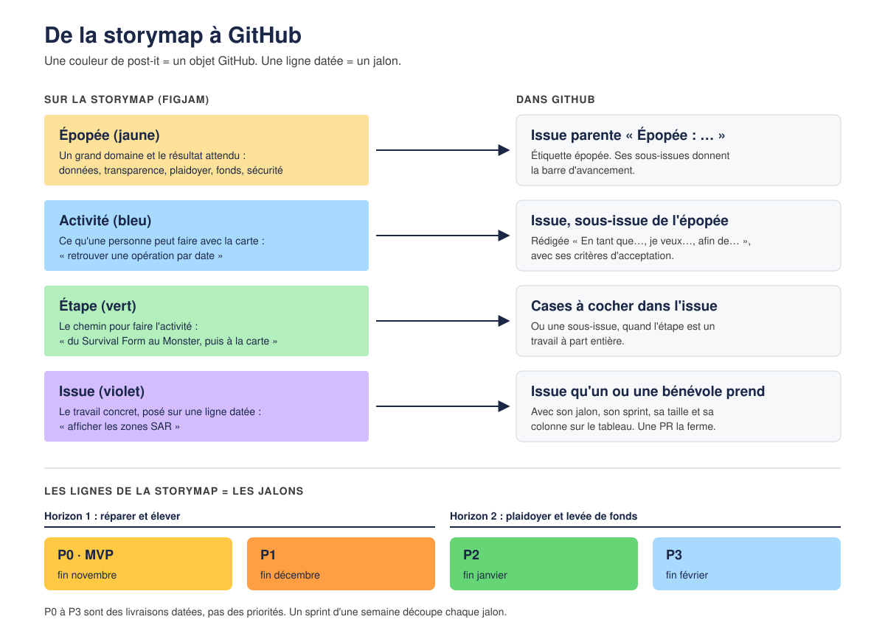

# De la storymap à GitHub

L'équipe produit (PO/PM) pense le projet sur le FigJam « Discovery canva » : vision, entretiens,
personas, storymap. La tech travaille dans GitHub. Cette page fait le lien entre les deux, pour
que chacun parle des mêmes choses avec les mêmes mots.

## La storymap, mot à mot

| Sur la storymap | Ce que c'est | Dans GitHub |
|---|---|---|
| **Vision** (en haut du FigJam) | « Une carte qui ne s'éteint jamais » : ce qu'on vise, à relire avant chaque choix | En tête du [README](../README.md) |
| **Épopée** (post-it jaune) | Un grand domaine et le résultat qu'on en attend : Data management, Transparence, Plaidoyer, Levée de fonds, Cybersécurité | Une issue parente « Épopée : … », étiquette `épopée`. Ses sous-issues donnent l'avancement |
| **Activité** (post-it bleu) | Ce qu'une personne peut faire avec le produit : retrouver une opération par date, lire le bilan cumulé | Une issue, sous-issue de son épopée, rédigée « En tant que…, je veux…, afin de… » avec ses critères |
| **Étape** (post-it vert) | Le chemin pour réaliser une activité : du logbook du navire au logbook web, du Survival Form au Monster puis à la carte | Des cases à cocher dans l'issue de l'activité, ou une sous-issue quand l'étape est un vrai travail |
| **Issue** (post-it violet) | Le travail concret, posé sur la ligne de sa livraison | Une issue prête à prendre : jalon, sprint, taille, colonne du tableau. Une pull request la ferme |
| **Post-it rose** | Une question ou un entretien à mener | Le suivi des PO/PM ; une issue seulement si du code en dépend |
| **Ligne P0, P1, P2, P3** | Une livraison datée : P0 (MVP) fin novembre, P1 fin décembre, P2 fin janvier, P3 fin février | Un [jalon](https://github.com/dataforgoodfr/mediterranean-rescue/milestones) avec sa date |
| **Horizon** | Horizon 1 : réparer et élever le produit existant (P0, P1). Horizon 2 : en faire un outil de plaidoyer et de levée de fonds (P2, P3) | Écrit dans la description des jalons |

P0 à P3 sont des **livraisons**, pas des priorités : une issue de P2 n'est pas moins importante,
elle vient plus tard.

## Le rythme

| Mot | Ce que c'est | Dans GitHub |
|---|---|---|
| **Sprint** | Une semaine de travail, du lundi au dimanche | Le champ « Sprint » du [tableau](https://github.com/orgs/dataforgoodfr/projects/44) |
| **Weekly** | Le point de la semaine : ce qui est livré, ce qui bloque, ce qu'on prend | On parcourt le tableau, sprint par sprint |
| **Colonne** | Où en est une issue : Backlog, Ready, In progress, In review, Done | Le champ « Status » du tableau |
| **Taille** | L'effort estimé : XS, S, M, L, XL. Une XL se découpe avant d'être prise | Le champ « Size » du tableau |
| **Prête** | Une issue qu'on peut prendre sans poser de question | La case « Prête à prendre » du modèle d'issue, puis la colonne Ready |
| **Faite** | Mergée, testée, et sa doc à jour | La case de la pull request, puis la colonne Done |

Le tableur des PO/PM suit les décisions et les actions produit. Il pointe vers les issues
GitHub par un lien, sans les recopier : pour le code, GitHub fait foi.

## Les autres pages du FigJam

Elles nourrissent les issues sans devenir des issues. Une issue y renvoie quand elle en dépend.

| Page | Ce qu'on y trouve |
|---|---|
| **#0 Produits existants** | La carte actuelle de SOS MEDITERRANEE et d'autres outils annotés (appels MRCC, Missing Migrants, Global Fishing Watch, Frontex) |
| **#1 Interview canva** | Les entretiens avec l'équipe de SOS MEDITERRANEE et une journaliste : besoins, irritants, ce qu'il faut garder |
| **#2 Lean UX canvas** | Le problème, les utilisateurs, les résultats attendus et les hypothèses à vérifier |
| **#3 Impact mapping** | Pourquoi (objectif), qui (acteur), comment (impact), quoi (livrable) |
| **#4 Proto-personas** | Paul (opérations, à bord), David (journaliste), Magda (gère la donnée), Samya (famille d'une personne qui a traversé), Tom (présente l'action de l'ONG) |
| **#5 Jobs to be done** | « Quand je…, je veux…, pour… » : le besoin sous l'action |
| **#6 Storymap** | Les épopées, activités, étapes et issues, rangées par livraison |

Un persona se cite dans l'issue (« Pour : Samya »). Les noms sont inventés : aucun ne
désigne une personne réelle.
